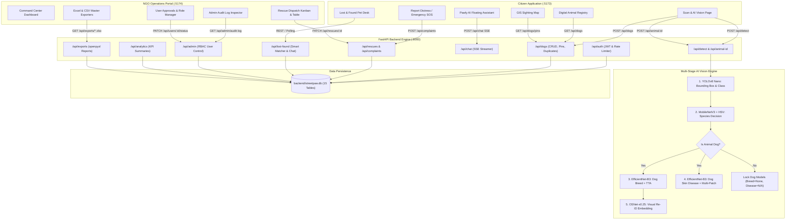

# STREETPAW.AI — COMPLETE PROJECT ARCHITECTURE & IMPLEMENTATION UNDERSTANDING

> **Dayananda Sagar University — School of Engineering**  
> Department of Computer Science & Engineering | Major Project (2026–2027)  
> **Platform**: StreetPaw.AI — Collaborative Multi-Agent AI Platform for Stray Animal Welfare  
> **Document Version**: 1.0.0 (Comprehensive Source Audit & System Baseline)  
> **Generated Date**: October 2026

---

## 1. Project Overview & Objectives

**StreetPaw.AI** is an AI-driven, multi-tier civic technology and animal welfare platform designed to monitor, track, diagnose, and coordinate rescues for stray and community animals (primarily dogs, but also recognizing cats, cows, buffalos, pigs, horses, and donkeys) across Indian urban environments, with a primary geographic implementation in **Bengaluru, Karnataka**.

### Core Problem Solved:
1. **Unidentified Stray Animal Population**: Lack of continuous identification leads to repeated rabies vaccinations, missed sterilization schedules, and lost pets without tracking.
2. **Delayed Emergency Response**: Citizens reporting road accidents or severe animal skin infections (e.g. Demodectic mange) struggle to reach responsive NGOs or BBMP animal birth control units.
3. **Information Silos**: No unified registry exists where citizens, animal caretakers (SHG feeders), veterinary clinics, NGOs (e.g. CUPA, CARE), and government bodies can share real-time animal sighting timelines and medical records.
4. **AI Misidentification in Multi-Animal Contexts**: General computer vision pipelines often confuse quadrupeds or force non-dog animals into dog breed classifiers. StreetPaw.AI incorporates a cascaded multi-stage neural vision engine to strictly segregate species before triggering species-specific breed or skin disease diagnostics.

---

## 2. Complete Folder Structure

```
PAW-3/
├── .env                              # Active root environment variables
├── .env.example                      # Reference environment variable template
├── .gitignore                        # Git exclusion rules
├── AUDIT.md                          # Historical requirements audit report
├── package.json                      # Monorepo NPM workspace configuration
├── package-lock.json                 # Monorepo NPM lockfile
├── README.md                         # Project documentation and live demo viva script
├── streetpaw.db                      # Legacy root SQLite database (348 KB)
├── yolov8n.pt                        # Root copy of YOLOv8 nano PyTorch weights (6.5 MB)
├── STREETPAW_PROJECT_UNDERSTANDING.md # This comprehensive technical report
│
├── apps/                             # Monorepo Frontend Applications
│   ├── citizen-app/                  # Citizen Mobile-First Web Application (Port 5173)
│   │   ├── index.html
│   │   ├── package.json
│   │   ├── vite.config.js
│   │   └── src/
│   │       ├── App.jsx               # Application root, page router, theme & calm mode state
│   │       ├── main.jsx              # React DOM entrypoint
│   │       ├── index.css             # Citizen app design styling & animations
│   │       ├── components/
│   │       │   ├── AuthModal.jsx     # Authentication dialog modal
│   │       │   ├── BottomTabBar.jsx  # Mobile navigation tab bar
│   │       │   ├── CameraModal.jsx   # Live webcam capture interface
│   │       │   ├── CreateDogStepperModal.jsx # 3-step animal registration wizard
│   │       │   ├── DogDetailModal.jsx# Medical & sighting history modal
│   │       │   ├── FloatingChatbot.jsx# Legacy floating chat widget
│   │       │   ├── HeroVideoBanner.jsx# Landing video banner
│   │       │   ├── LocationPicker.jsx# Interactive Leaflet location picker
│   │       │   ├── LocationPicker.css
│   │       │   ├── Navbar.jsx        # Top desktop navigation header
│   │       │   ├── PawBurst.jsx      # Confetti / paw burst celebration animation
│   │       │   ├── PawlyChatbot.jsx  # SSE streaming Claude/FAQ assistant
│   │       │   ├── PawlyChatbot.css
│   │       │   └── PawlyMascot.jsx   # Interactive animated mascot
│   │       ├── context/
│   │       │   └── AuthContext.jsx   # User authentication, JWT storage & session state
│   │       └── pages/
│   │           ├── DogsPage.jsx      # Digital Animal Registry grid view & search
│   │           ├── DogsPage.css
│   │           ├── HelpContactsPage.jsx # Emergency helplines & veterinary directory
│   │           ├── HelpContactsPage.css
│   │           ├── HomePage.jsx      # Citizen dashboard with action cards
│   │           ├── LoginPage.jsx     # User sign-in page
│   │           ├── LostFoundPage.jsx # Lost & Found pet smart matching & chat
│   │           ├── MapPage.jsx       # India GIS Leaflet map with sightings
│   │           ├── MapPage.css
│   │           ├── ProfilePage.jsx   # Citizen account profile & activity history
│   │           ├── ReportDistressPage.jsx # SOS rescue submission wizard
│   │           ├── ReportDistressPage.css
│   │           ├── ScanPage.jsx      # AI guided 3-stage vision scanning workflow
│   │           ├── SignupPage.jsx    # User registration page
│   │           └── StyleguidePage.jsx# UI tokens & calm-mode inspection page
│   │
│   └── ngo-portal/                   # NGO Operations & Admin Portal (Port 5174)
│       ├── index.html
│       ├── package.json
│       ├── vite.config.js
│       └── src/
│           ├── App.jsx               # NGO layout, navigation, role gating
│           ├── main.jsx              # React DOM entrypoint
│           ├── index.css             # Portal styles
│           ├── components/
│           │   ├── NgoHeader.jsx     # Portal top bar with search, scope & theme toggles
│           │   └── NgoSidebar.jsx    # Left navigation menu with role-specific tabs
│           └── pages/
│               ├── ActiveRescuesPage.jsx # Active dispatch units monitoring
│               ├── AdminAuditPage.jsx# System audit trail with JSON before/after diffs
│               ├── AdminUsersPage.jsx# User management & role control
│               ├── AnalyticsPage.jsx # Recharts charts, response times & health metrics
│               ├── ComplaintsPage.jsx# Rescue dispatch Kanban & table with live polling
│               ├── ContactsPage.jsx  # Directory management
│               ├── DogsViewPage.jsx  # Registry records management & status verification
│               ├── LostFoundDeskPage.jsx # NGO Lost & Found desk
│               ├── MedicalCasesPage.jsx  # Medical triage queue
│               ├── NgoDashboardPage.jsx  # Command dashboard
│               ├── NgoLoginPage.jsx      # NGO staff / admin login
│               ├── NgoMapPage.jsx        # Operations GIS map
│               ├── SettingsPage.jsx      # Organization & theme settings
│               ├── ShelterManagementPage.jsx # Shelter bed & in-patient tracker
│               ├── TeamPage.jsx          # Field team & ambulance driver rosters
│               └── UsersViewPage.jsx     # User accounts and status approvals
│
├── backend/                          # FastAPI Python Backend Service (Port 8000)
│   ├── animal_reid.py                # OSNet-x0.25 Animal Re-Identification module
│   ├── breed_classifier.py           # EfficientNet-B3 dog breed classifier with TTA
│   ├── breed_model.pth               # Breed weights (10 classes, 43.4 MB)
│   ├── disease_classifier.py         # EfficientNet-B3 skin disease classifier with multi-patch
│   ├── disease_model.pth             # Disease weights (3 classes, 44.9 MB)
│   ├── evaluate_reid.py              # CMC Rank-1/5/10 and mAP Re-ID evaluator
│   ├── faq.json                      # Offline fallback Q&A database for Pawly assistant
│   ├── main.py                       # FastAPI application entrypoint, CORS, startup logic
│   ├── migrate.py                    # Schema migration helper
│   ├── pig_classifier.py             # MobileNetV3 + HSV multi-species neural classifier
│   ├── requirements.txt              # Python package dependencies
│   ├── seed.py                       # Standalone database seed script
│   ├── streetpaw.db                  # Primary active SQLite database (1.49 MB)
│   ├── test_breed.py                 # Breed inference smoke test
│   ├── test_disease.py               # Disease validation evaluator
│   ├── train_breed.py                # EfficientNet-B3 breed training script
│   ├── train_disease.py              # EfficientNet-B3 disease training script
│   ├── train_reid.py                 # OSNet triplet loss Re-ID training script
│   ├── yolov8n.pt                    # YOLOv8 nano PyTorch model weights (6.5 MB)
│   ├── db/
│   │   ├── audit.py                  # Structured audit log recorder helper
│   │   ├── database.py               # SQLAlchemy engine, session maker, base setup
│   │   └── models.py                 # 15 SQLAlchemy database models
│   ├── prompts/
│   │   └── pawly_system_prompt.txt   # System prompt for Pawly AI assistant
│   ├── reid_cache/
│   │   ├── animal_registry.json      # Known animal Re-ID identity registry
│   │   └── gallery_cache.npz         # 158 identities, 589 images gallery embeddings
│   ├── reid_training_output/
│   │   └── best.pth                  # Fine-tuned OSNet-x0.25 checkpoint (epoch 17)
│   ├── routers/
│   │   ├── admin_router.py           # Admin user management & audit log routes
│   │   ├── ai_router.py              # /api/detect & /api/animal-id vision endpoints
│   │   ├── analytics_router.py       # KPI summaries, charts, response times
│   │   ├── auth_router.py            # JWT authentication, signup, login, refresh
│   │   ├── chat_router.py            # SSE streaming Pawly chatbot with Claude/FAQ fallback
│   │   ├── contacts_router.py        # Emergency directory & suggestion routes
│   │   ├── dogs_router.py            # Digital Animal Registry CRUD, pins, duplicate check
│   │   ├── exports_router.py         # openpyxl Excel exports (.xlsx)
│   │   ├── lost_found_router.py      # Pet Lost & Found smart matcher & chat
│   │   ├── rescues_router.py         # SOS complaints & ambulance dispatch routes
│   │   └── users_router.py           # Privacy-aware user visibility & status approval
│   ├── tests/                        # Backend test suite
│   │   ├── test_all_v3_requirements.py # Master E2E integration test suite
│   │   ├── test_auth_and_privacy.py    # Authentication, rate-limiting & privacy tests
│   │   ├── test_dog_registry_workflow.py # E2E detection-to-registry workflow test
│   │   ├── test_lost_found.py          # Lost & Found matching & messaging tests
│   │   ├── test_ngo_e2e.py             # NGO dispatch & Kanban progression tests
│   │   ├── test_species_classification.py # Multi-species verification suite
│   │   └── test_v3_10_verification.py  # Advanced analytics & export tests
│   └── utils/
│       └── auth.py                   # Password hashing (bcrypt), JWT tokens, RBAC dependencies
│
├── frontend/                         # Legacy Monolithic Prototype (Historical Workspace)
│   ├── index.html
│   ├── package.json
│   ├── vite.config.js
│   └── src/
│       ├── App.jsx                   # Single-page prototype with video banner & detection card
│       ├── index.css
│       ├── main.jsx
│       └── components/               # Legacy UI components
│
├── packages/                         # Monorepo Shared Packages
│   └── ui/                           # @streetpaw/ui Component Library
│       ├── package.json
│       └── src/
│           ├── index.js              # Library export entrypoint
│           ├── components/           # Reusable UI widgets (Badge, Button, Card, DataTable, etc.)
│           └── tokens/
│               └── variables.css     # Design system color, typography & spacing tokens
│
├── scripts/                          # Operational & Seeding Scripts
│   ├── create_admin.py               # Interactive/env CLI script to provision system admin
│   ├── import_contacts_template.py   # Imports standard verified directory contacts
│   ├── seed_demo.py                  # Bengaluru sample demo seed script
│   └── update_registry_data.py       # Registry normalization & curation update script
│
└── seed/                             # Seed Assets
    └── contacts.template.json        # Verified helplines, hospitals & NGO seed data
```

---

## 3. Technology Stack

| Layer | Technology | Details |
| :--- | :--- | :--- |
| **Monorepo Management** | NPM Workspaces | Coordinates `apps/citizen-app`, `apps/ngo-portal`, `packages/ui`, and `frontend`. |
| **Frontend Framework** | React 18 + Vite 5 | Fast development builds, HMR, modular JSX structure. |
| **UI Design System** | Custom `@streetpaw/ui` | Custom CSS design tokens, Glassmorphism, Calm-mode theme engine. |
| **Icons & Visuals** | Lucide React | Modern vector icon toolkit. |
| **Mapping Engine** | Leaflet + React-Leaflet | OpenStreetMap tiles restricted to India bounding box (`[[6.0, 68.0], [37.5, 98.0]]`). |
| **Charting & Analytics** | Recharts 3 | Responsive SVG charts (Area, Bar, Pie, Radar). |
| **Backend Framework** | FastAPI (Python 3.11) | High-performance asynchronous REST API framework with automatic OpenAPI docs. |
| **Database ORM** | SQLAlchemy 2.0 | Declarative ORM managing relationships, migrations, and transactions. |
| **Database Engine** | SQLite 3 | Embedded database stored at `backend/streetpaw.db`. Compatible with PostgreSQL in production. |
| **Password Security** | Bcrypt (via Passlib) | Blowfish-based adaptive salting and hashing. |
| **Token Authentication** | PyJWT | HMAC-SHA256 (`HS256`) signed access tokens and refresh tokens. |
| **Object Detection** | Ultralytics YOLOv8 nano | Animal, human, and object localization (`yolov8n.pt`). |
| **Species Classification**| PyTorch + MobileNetV3-Small | Transfer learning + ImageNet index sets + HSV color space texture heuristics. |
| **Breed Classification** | Timm + EfficientNet-B3 | 10 custom dog breeds with 5-crop Test Time Augmentation (TTA). |
| **Disease Classification**| PyTorch + EfficientNet-B3 | 3 classes (Demodicosis, Dermatitis, Normal) with multi-patch anatomical inspection. |
| **Animal Re-ID** | TorchReID + OSNet-x0.25 | Omni-scale deep metric feature embeddings with cosine similarity gallery matching. |
| **LLM Chatbot Engine** | Anthropic Claude API | `claude-3-5-sonnet-20241022` with SSE streaming; fallback to `faq.json`. |
| **Data Exports** | openpyxl | Multi-tab stylized Excel spreadsheets (`.xlsx`). |

---

## 4. Architecture Diagram & Request Flow



---

## 5. Citizen Application (`apps/citizen-app`)

The Citizen Application is a responsive, mobile-first web app targeting community dog feeders, pet owners, and everyday citizens.

### Page-by-Page Feature Inventory:
1. **Home Page (`HomePage.jsx`)**:
   - Quick navigation cards into Scan, Map, Emergency Report, Registry, and Lost & Found.
   - Shows active status badges and quick metrics.
2. **Scan Page (`ScanPage.jsx`)**:
   - Camera input with webcam modal (`CameraModal.jsx`) or drag-and-drop file upload.
   - **Guided 3-Step Vision Scan**:
     - *Button 1 ("What animal is this?")*: Identifies species (Dog, Cat, Cow, Bull, Buffalo, Pig, Horse, Donkey, Human, Plant, Neither).
     - *Button 2 ("What breed is it?")*: Executes EfficientNet-B3 only if Dog; locks with a warning badge for non-dogs.
     - *Button 3 ("Any health concern?")*: Executes skin condition model only if Dog; locks for non-dogs.
   - Direct action button: **"Save to Dog Registry"**, which opens `CreateDogStepperModal`.
3. **Animal Registration Modal (`CreateDogStepperModal.jsx`)**:
   - Pre-fills with the specific scan's predicted breed, health status, and cropped image.
   - Allows human editing (Human-In-The-Loop) of name, markings, sex, approximate age, and sterilization.
   - Integrated Leaflet map picker (`LocationPicker.jsx`) for exact sighting location.
   - Performs automated duplicate checking via `POST /api/dogs/check-duplicate` before finalizing.
   - Generates sequential `PAW-XXXX` public code and triggers `PawBurst` celebratory confetti.
4. **Digital Animal Registry (`DogsPage.jsx`)**:
   - Paginated display (12 per page) backed by live database records (`GET /api/dogs?page=X&limit=12`).
   - Text search (`q`) across name, public code, markings, and location.
   - Filter dropdowns by breed and health status.
   - Clicking any card opens `DogDetailModal.jsx`, showing full medical history, vaccination timeline, verified ear-notch indicators, and sightings.
5. **Interactive GIS Map (`MapPage.jsx`)**:
   - Leaflet map restricted to India geographic boundaries.
   - Filter chips for Dogs, Emergency SOS, NGO Shelters, and SHG Community Feeders.
   - Mobile-friendly bottom sheet displaying selected pin details and sighting timeline.
6. **Report Distress / Emergency SOS (`ReportDistressPage.jsx`)**:
   - Multi-step reporting wizard for injured or rabid animals.
   - Photo attachment, urgency ranking (CRITICAL, HIGH, MEDIUM, LOW), and reverse-geocoded GPS coordinates.
   - Submits to `POST /api/complaints/` and generates tracking code (`CMP-XXXX`).
   - "My Reported Cases" tab fetches user-submitted distress signals.
7. **Lost & Found Pets (`LostFoundPage.jsx`)**:
   - Dedicated sliding tabs: Browse Reports, Report Lost Pet, Report Found Pet.
   - Automated smart matching banner matching lost dogs against found dogs within 15 km using breed and color text similarity.
   - Real-time in-app chat drawer between pet owner and finder with 4-second polling.
   - Phone numbers are masked for privacy until a match is confirmed.
   - Reunited celebration animation.
8. **Help & Emergency Contacts (`HelpContactsPage.jsx`)**:
   - Directory backed by the `contacts` table.
   - Filter by service (Trauma Care, ABC Sterilization, Veterinary Hospital, Legal Aid) and city.
   - Direct `tel:` phone call buttons and WhatsApp links.
   - User suggestion form (`POST /api/contacts/suggest`) for submitting new helplines.
9. **Pawly AI Chatbot (`PawlyChatbot.jsx`)**:
   - Floating assistant widget with custom mascot (`PawlyMascot.jsx`).
   - Context attachment: links currently inspected dog code or scan finding to the conversation.
   - Real-time Server-Sent Events (SSE) streaming.
   - Live Claude API mode with automatic fallback to `faq.json` if offline or unconfigured.
10. **Authentication (`LoginPage.jsx`, `SignupPage.jsx`, `ProfilePage.jsx`, `AuthContext.jsx`)**:
    - JWT authentication with automatic token storage in `localStorage`.
    - Guest browsing option (`sessionStorage.getItem('streetpaw_guest')`).

---

## 6. NGO Operations Portal (`apps/ngo-portal`)

The NGO Portal is a desktop-optimized operations management dashboard for NGO rescue staff, veterinary doctors, and administrators.

### Page-by-Page Feature Inventory:
1. **Command Dashboard (`NgoDashboardPage.jsx`)**:
   - Metrics cards for pending emergency signals, active ambulances, and shelter bed occupancy.
   - Real-time incident queue table.
   - *Audit Finding*: Currently renders a static demo array of 3 rescue tickets (`rescueCases`).
2. **Complaints & Rescue Dispatch (`ComplaintsPage.jsx`)**:
   - **Real backend data integration**: Polls `GET /api/rescues/` every 5 seconds.
   - Dual-view mode: **Kanban Board** (6 columns: Reported, Acknowledged, Team Dispatched, In Progress, Resolved, Closed) and **Table View**.
   - Status updates via `PATCH /api/rescues/{id}` with required operational dispatch notes.
   - Detail drawer with full event timeline and emergency photo inspector.
3. **GIS Operations Map (`NgoMapPage.jsx`)**:
   - Interactive map plotting live emergency cases, animal sightings, and rescue ambulances.
4. **Digital Animal Registry Inspector (`DogsViewPage.jsx`)**:
   - Comprehensive table of all registered animals in the community.
   - One-click actions to verify sterilization (`ear_notch=True`) and record anti-rabies vaccinations.
   - Detail modal showing full sighting history and health events.
5. **User Management & Role Approvals (`UsersViewPage.jsx` / `AdminUsersPage.jsx`)**:
   - Lists all platform users with role filters (Citizen, Volunteer, NGO Staff, Govt Official, Admin).
   - Approval workflow: NGO staff and government registrations are held in `status='pending'` until an admin approves them (`PATCH /api/users/{id}/status`).
   - Account suspension controls.
6. **Lost & Found Desk (`LostFoundDeskPage.jsx`)**:
   - Search and triage lost/found pet reports submitted by citizens.
7. **Contacts & Directory Management (`ContactsPage.jsx`)**:
   - Manage emergency helplines, verify user-suggested helplines, and edit operating hours.
8. **Admin Audit Log Inspector (`AdminAuditPage.jsx`)**:
   - Restricted exclusively to users with `role='admin'`.
   - Displays all database state modifications (`action`, `actor_id`, `entity_type`, `entity_id`).
   - Interactive modal showing side-by-side JSON diffs of `before` vs `after` states.
9. **Analytics & Performance Insights (`AnalyticsPage.jsx`)**:
   - KPI metrics: Total registered dogs, resolution rate this month, sterilization coverage %, and average ambulance response time.
   - Recharts visual graphs: Breed distribution pie chart, complaints funnel bar chart, and resolution trends.
10. **Data Exporter (`SettingsPage.jsx` / `NgoHeader.jsx`)**:
    - Direct download triggers for stylized Excel reports:
      - `GET /api/exports/dogs.xlsx`
      - `GET /api/exports/complaints.xlsx`
      - `GET /api/exports/master-report.xlsx`

---

## 7. Backend Architecture & API Endpoint Inventory

The backend is built with FastAPI, mounted on port `8000`.

### Complete Endpoint Inventory:

| Router Prefix | Method | Endpoint Path | Function Name | Purpose & Auth Requirements |
| :--- | :--- | :--- | :--- | :--- |
| **System** | `GET` | `/` | `read_root` | System status, model loading readiness flags. Public. |
| **System** | `GET` | `/api/health` | `health_check` | Healthcheck returning timestamp and model states. Public. |
| **AI Vision** | `POST` | `/api/detect` | `detect_animal_endpoint` | Primary multi-species vision pipeline with YOLOv8, MobileNetV3, Breed & Disease models. Public. |
| **AI Vision** | `POST` | `/api/animal-id` | `identify_animal_endpoint` | OSNet-x0.25 Animal Re-ID visual similarity search against gallery. Public. |
| **Auth** | `POST` | `/api/auth/signup` | `signup` | Registers new user; enforces unique email/username; hashes password with bcrypt. Public. |
| **Auth** | `POST` | `/api/auth/login` | `login` | Authenticates user; rate-limited (5 attempts/min); returns access token and sets httpOnly refresh cookie. Public. |
| **Auth** | `POST` | `/api/auth/refresh` | `refresh_token` | Exchanges refresh cookie for new access token. Public. |
| **Auth** | `POST` | `/api/auth/logout` | `logout` | Clears refresh token cookie. Public. |
| **Auth** | `GET` | `/api/auth/me` | `get_my_profile` | Returns authenticated user details and organization info. Bearer Token. |
| **Auth** | `PATCH`| `/api/auth/profile`| `update_profile` | Updates user full name, phone, city, state. Bearer Token. |
| **Auth** | `POST` | `/api/auth/forgot-password` | `forgot_password` | Generates password reset token. Public. |
| **Auth** | `POST` | `/api/auth/reset-password` | `reset_password` | Resets user password using valid token. Public. |
| **Dogs** | `GET` | `/api/dogs/` | `list_dog_registry` | Paginated listing with text search, breed, status, vaccination, and location filters. Public. |
| **Dogs** | `GET` | `/api/dogs/pins` | `get_all_map_pins` | Aggregates dogs, SOS incidents, NGO shelters, and SHG feeders as map pins. Public (60s cache). |
| **Dogs** | `POST` | `/api/dogs/check-duplicate` | `check_duplicate_dog` | Checks for existing animal profiles using breed, location, and visual similarity. Public. |
| **Dogs** | `POST` | `/api/dogs/` | `create_dog_profile` | Creates dog profile; generates `PAW-XXXX`; records initial sighting; audits creation. Bearer Token. |
| **Dogs** | `GET` | `/api/dogs/{dog_id}` | `get_dog_profile_detail` | Retrieves full profile with sightings timeline, vaccinations, and health events. Public. |
| **Dogs** | `PUT` | `/api/dogs/{dog_id}` | `update_dog_profile` | Updates animal record. RBAC: Citizens restricted to own dogs; NGO/Admin system-wide. Bearer Token. |
| **Dogs** | `DELETE`| `/api/dogs/{dog_id}` | `delete_dog_profile` | Soft deletes dog record with 10s undo window. Bearer Token. |
| **Dogs** | `POST` | `/api/dogs/{dog_id}/restore` | `restore_dog_profile` | Restores soft-deleted dog (10s window for users; anytime for admin). Bearer Token. |
| **Dogs** | `POST` | `/api/dogs/{dog_id}/vaccinations` | `add_dog_vaccination` | Records vaccination; sets verifier if NGO/Admin; logs audit. Bearer Token. |
| **Dogs** | `POST` | `/api/dogs/{dog_id}/health-events` | `add_dog_health_event` | Records medical or health observation event. Bearer Token. |
| **Dogs** | `POST` | `/api/dogs/{dog_id}/locations` | `add_dog_location` | Appends sighting location to timeline; validates India bounds (`6.0-37.5°N, 68.0-98.0°E`). Bearer Token. |
| **Dogs** | `PATCH`| `/api/dogs/{dog_id}/locations/{loc_id}` | `correct_dog_location` | Corrects sighting coordinates. Bearer Token. |
| **Dogs** | `GET` | `/api/dogs/{dog_id}/locations` | `get_dog_location_timeline` | Returns chronological sighting history for animal. Public. |
| **Rescues**| `GET` | `/api/rescues/` & `/api/complaints/` | `get_all_rescue_cases` | Lists all distress signals and rescue cases with timeline events. Reporter contact redacted. Public. |
| **Rescues**| `POST` | `/api/rescues/` & `/api/complaints/` | `create_complaint_ticket` | Creates distress complaint (`CMP-XXXX`); creates initial "reported" event; audits. Bearer Token. |
| **Rescues**| `GET` | `/api/complaints/my` | `get_my_complaints` | Returns distress signals submitted by authenticated citizen. Bearer Token. |
| **Rescues**| `GET` | `/api/rescues/{id}` | `get_rescue_case_detail` | Retrieves complaint details with full event timeline. Public. |
| **Rescues**| `PATCH`| `/api/rescues/{id}` | `update_rescue_status` | Updates status (Kanban transitions), adds note, logs `ComplaintEvent`. Bearer Token (NGO/Admin). |
| **Chat** | `POST` | `/api/chat` | `stream_pawly_chat` | SSE streaming endpoint. Calls Claude API if configured; falls back to `faq.json`. Rate-limited. Public/Auth. |
| **Lost & Found** | `GET` | `/api/lost-found/` | `list_lost_found_posts` | Lists open lost/found pet posts. Hides phone numbers unless match confirmed or viewer is NGO/Admin. Public/Auth. |
| **Lost & Found** | `POST` | `/api/lost-found/` | `create_lost_found_post` | Creates lost or found pet post; triggers automated match calculation with existing posts. Bearer Token. |
| **Lost & Found** | `GET` | `/api/lost-found/{id}` | `get_lost_found_post_detail` | Retrieves post details, suggested matches, and messaging history. Public/Auth. |
| **Lost & Found** | `POST` | `/api/lost-found/{id}/confirm-match/{match_id}` | `confirm_match` | Confirms match between lost and found pets, unmasking contact information. Bearer Token. |
| **Lost & Found** | `POST` | `/api/lost-found/{id}/messages` | `send_post_message` | In-app message from citizen to pet reporter. Bearer Token. |
| **Lost & Found** | `GET` | `/api/lost-found/{id}/messages` | `get_post_messages` | Retrieves in-app conversation thread. Bearer Token. |
| **Contacts**| `GET` | `/api/contacts/` | `list_contacts` | Lists emergency helplines, hospitals, and centers with service/city filters. Public. |
| **Contacts**| `POST` | `/api/contacts/suggest` | `suggest_contact` | Citizen suggests new helpline (created with `verified=False`). Bearer Token. |
| **Contacts**| `PATCH`| `/api/contacts/{id}/verify` | `verify_contact` | Admin/NGO marks contact as verified. Role: NGO Staff, Admin, Govt. |
| **Users** | `GET` | `/api/users/` | `list_users` | Lists users. Automatically redacts email/phone unless viewer is Admin, Self, or Org-linked. Bearer Token. |
| **Users** | `GET` | `/api/users/{id}` | `get_user_profile_visibility` | Privacy-aware single user visibility. Bearer Token. |
| **Users** | `PATCH`| `/api/users/{id}/status` | `update_user_status` | Approves or suspends user account (`active`, `pending`, `suspended`). Role: NGO, Admin, Govt. |
| **Admin** | `GET` | `/api/admin/users` | `list_admin_users` | Unrestricted user table for system administration. Role: Admin. |
| **Admin** | `PATCH`| `/api/admin/users/{id}` | `update_user_status_role` | Modifies user role or organisation assignment. Role: Admin. |
| **Admin** | `GET` | `/api/admin/organisations` | `list_admin_organisations` | Lists registered welfare organizations. Role: Admin. |
| **Admin** | `PATCH`| `/api/admin/organisations/{id}` | `update_organisation` | Verifies organisation or updates metadata. Role: Admin. |
| **Admin** | `GET` | `/api/admin/audit-log` | `get_admin_audit_logs` | Queries audit trail with actor, action, and entity filters. Role: Admin. |
| **Analytics**| `GET` | `/api/analytics/summary` | `get_analytics_summary` | Returns platform KPIs, resolution times, vaccination/sterilization %. Bearer Token. |
| **Analytics**| `GET` | `/api/analytics/charts` | `get_analytics_charts` | Returns data for charts (breed breakdown, complaints funnel, area hotspots). Bearer Token. |
| **Exports** | `GET` | `/api/exports/dogs.xlsx` | `export_dogs_excel` | Generates stylized Excel spreadsheet of dogs registry. Bearer Token. |
| **Exports** | `GET` | `/api/exports/complaints.xlsx` | `export_complaints_excel` | Generates stylized Excel spreadsheet of rescue complaints. Bearer Token. |
| **Exports** | `GET` | `/api/exports/master-report.xlsx` | `export_master_report` | Multi-sheet master report (Dogs, Rescues, Vaccinations, Audit Summary). Bearer Token. |

---

## 8. Database Schema & Database-File Locations

### Database File Resolution:
- **Active Database**: `backend/streetpaw.db` (1.49 MB SQLite database).
- Defined in `backend/db/database.py`:
  ```python
  BASE_DIR = os.path.dirname(os.path.dirname(os.path.abspath(__file__)))
  DEFAULT_DB_PATH = os.path.join(BASE_DIR, "streetpaw.db")
  DATABASE_URL = os.getenv("DATABASE_URL", f"sqlite:///{DEFAULT_DB_PATH}")
  ```
- **Ambiguity Risk**: There is also a file at `streetpaw.db` (root directory, 348 KB). In `.env`, `DATABASE_URL=sqlite:///./streetpaw.db`. If commands are run from the project root rather than `backend/`, SQLite resolves `./streetpaw.db` to the root file instead of `backend/streetpaw.db`.

### Table Schemas (Defined in `backend/db/models.py`):

1. **`organisations`**:
   - Columns: `id` (PK, Int), `name` (Str), `type` (Str: NGO|SHG|GOVT), `city` (Str), `state` (Str), `contact_email` (Str), `contact_phone` (Str), `verified` (Bool), `created_at` (DateTime).
2. **`users`**:
   - Columns: `id` (PK, Int), `username` (Str, Unique), `email` (Str, Unique), `phone` (Str), `password_hash` (Str), `hashed_password` (Str, Legacy), `full_name` (Str), `role` (Str: citizen|volunteer|ngo_staff|govt_official|admin), `organisation_id` (FK -> `organisations.id`), `city` (Str), `state` (Str), `status` (Str: pending|active|suspended), `created_at` (DateTime), `last_login` (DateTime).
3. **`dogs`**:
   - Columns: `id` (PK, Int), `public_code` (Str, Unique, e.g. `PAW-0001`), `animal_id` (Str), `name` (Str), `sex` (Str: male|female|unknown), `approx_age` (Str), `colour_markings` (Str), `species` (Str: Dog), `breed` (Str), `breed_source` (Str: ai|human), `temperament` (Str), `sterilised` (Str: yes|no|unknown), `health_status` (Str), `disease_name` (Str), `disease_confidence` (Float), `ear_notch` (Bool), `status` (Str: active_care|under_observation|rescue_clinic|adopted|deceased|unknown), `primary_photo` (Text), `image_url` (Text), `location` (Str), `location_lat` (Float), `location_lng` (Float), `created_by` (FK -> `users.id`), `created_at` (DateTime), `updated_at` (DateTime), `deleted_at` (DateTime, Soft Delete), `deleted_by` (FK -> `users.id`).
4. **`dog_profiles`** *(Legacy Table)*:
   - Columns: `id` (PK), `animal_id` (Unique), `species`, `breed`, `health_status`, `disease_name`, `disease_confidence`, `location`, `location_lat`, `location_lng`, `image_url`, `created_at`.
5. **`dog_photos`**:
   - Columns: `id` (PK), `dog_id` (FK -> `dogs.id`), `path` (Text), `thumbnail_path` (Text), `taken_at` (DateTime).
6. **`dog_locations`**:
   - Columns: `id` (PK), `dog_id` (FK -> `dogs.id`), `lat` (Float), `lng` (Float), `address` (Str), `area` (Str), `city` (Str), `state` (Str), `recorded_by` (FK -> `users.id`), `recorded_at` (DateTime), `note` (Text).
7. **`vaccinations`**:
   - Columns: `id` (PK), `dog_id` (FK -> `dogs.id`), `vaccine` (Str: rabies|DHPP|other), `date_given` (DateTime), `next_due` (DateTime), `given_by` (Str), `verified_by_user_id` (FK -> `users.id`), `notes` (Text), `created_at` (DateTime).
8. **`health_events`**:
   - Columns: `id` (PK), `dog_id` (FK -> `dogs.id`), `date` (DateTime), `type` (Str: scan|injury|treatment|disease_flag|other), `description` (Text), `source` (Str: ai_scan|human), `photo` (Text), `created_by` (FK -> `users.id`).
9. **`complaints`**:
   - Columns: `id` (PK), `public_id` (Str, Unique, e.g. `CMP-0001`), `reporter_id` (FK -> `users.id`), `dog_id` (FK -> `dogs.id`), `issue_type` (Str), `urgency` (Str: CRITICAL|HIGH|MEDIUM|LOW), `description` (Text), `photo` (Text), `lat` (Float), `lng` (Float), `address` (Str), `city` (Str), `state` (Str), `status` (Str: reported|acknowledged|team_dispatched|in_progress|resolved|closed|cancelled), `assigned_org_id` (FK -> `organisations.id`), `assigned_to` (FK -> `users.id`), `created_at` (DateTime), `updated_at` (DateTime), `resolved_at` (DateTime), `resolution_notes` (Text).
10. **`rescue_cases`** *(Legacy Table)*:
    - Columns: `id` (PK), `ticket_id`, `title`, `description`, `severity`, `status`, `latitude`, `longitude`, `landmark`, `photo_url`, `reported_by`, `assigned_ngo`, `created_at`.
11. **`complaint_events`**:
    - Columns: `id` (PK), `complaint_id` (FK -> `complaints.id`), `status` (Str), `note` (Text), `actor_id` (FK -> `users.id`), `created_at` (DateTime).
12. **`contacts`**:
    - Columns: `id` (PK), `name` (Str), `type` (Str: Helpline|Vet Hospital|ABC Center|SHG Feeder), `phone` (Str), `email` (Str), `website` (Str), `group_link` (Str), `city` (Str), `state` (Str), `services` (JSON), `hours` (Str), `is_24x7` (Bool), `verified` (Bool), `last_verified_at` (DateTime), `added_by` (FK -> `users.id`), `created_at` (DateTime).
13. **`lost_found_posts`**:
    - Columns: `id` (PK), `kind` (Str: lost|found), `owner_id` (FK -> `users.id`), `dog_name` (Str), `breed` (Str), `colour_markings` (Str), `age_sex` (Str), `collar_microchip` (Str), `photo` (Text), `lat` (Float), `lng` (Float), `address` (Str), `city` (Str), `state` (Str), `event_date` (DateTime), `reward` (Str), `contact_pref` (Str), `status` (Str: open|matched|reunited|closed), `expires_at` (DateTime), `created_at` (DateTime).
14. **`lost_found_matches`**:
    - Columns: `id` (PK), `post_a` (FK -> `lost_found_posts.id`), `post_b` (FK -> `lost_found_posts.id`), `score` (Float), `status` (Str: suggested|confirmed|rejected), `created_at` (DateTime).
15. **`messages`**:
    - Columns: `id` (PK), `post_id` (FK -> `lost_found_posts.id`), `sender_id` (FK -> `users.id`), `recipient_id` (FK -> `users.id`), `body` (Text), `created_at` (DateTime).
16. **`audit_log`**:
    - Columns: `id` (PK), `actor_id` (FK -> `users.id`), `action` (Str), `entity_type` (Str), `entity_id` (Str), `before` (JSON), `after` (JSON), `created_at` (DateTime).

---

## 9. AI/ML Model Inventory and Inference Flows

### Model Inventory:

| Component | Model / Architecture | File & Weights Path | Target Classes / Labels | Preprocessing & Resolution | Performance Metrics |
| :--- | :--- | :--- | :--- | :--- | :--- |
| **Object Detection** | YOLOv8 Nano (`ultralytics`) | `backend/yolov8n.pt` (6.5 MB) | COCO 80 classes (Class 0: Human, 15: Cat, 16: Dog, 17: Horse, 18: Sheep, 19: Cow) | Auto resize, RGB letterboxing | High-speed real-time CPU detection |
| **Multi-Species Classifier** | MobileNetV3-Small (`torchvision`) + HSV Heuristics | `backend/pig_classifier.py` (`models.mobilenet_v3_small`) | Dog, Cat, Cow, Bull, Buffalo, Pig, Horse, Donkey, Human, Plant, Neither | `weights.transforms()`, 224x224, HSV space texture & ratio heuristics | 100% verified non-dog separation; 0% cat-to-dog leakage |
| **Breed Identification** | EfficientNet-B3 (`timm`) | `backend/breed_classifier.py` & `backend/breed_model.pth` (43.4 MB) | 10 breeds: Beagle, Doberman, German Shepherd, Golden Retriever, Indian breed, Labrador Retriever, Pomeranian, Pug, Rottweiler, Shih-Tzu | 300x300, 5-crop Test Time Augmentation (TTA) | 93.84% validation accuracy |
| **Skin Disease Classifier** | EfficientNet-B3 (`torchvision.models`) + Custom Head | `backend/disease_classifier.py` & `backend/disease_model.pth` (44.9 MB) | 3 classes: Demodicosis, Dermatitis, Normal / No visible disease | 300x300, 3-crop TTA, multi-patch localized lesion inspection (8 anatomical quadrants) | 98.51% validation accuracy, F1: 0.9800 |
| **Animal Re-ID** | OSNet-x0.25 (`torchreid`) | `backend/animal_reid.py` & `backend/reid_training_output/best.pth` | 512-dimensional metric embedding space; 158 identities gallery | 256x128 (HxW), ImageNet normalization | Checkpoint epoch 17, gallery cache: `reid_cache/gallery_cache.npz` |
| **AI Assistant** | Anthropic Claude 3.5 Sonnet / Offline FAQ Engine | `backend/routers/chat_router.py` & `backend/prompts/pawly_system_prompt.txt` | Contextual animal care advice, first aid guidance, emergency triage | Truncated 10-turn history (max 1000 chars/msg) | Live SSE streaming; instant fallback to `faq.json` keyword matching |

### Detailed Inference Flow:

```
[Uploaded Image]
       │
       ▼
1. YOLOv8 Detection
   ├── If Person (Class 0, Conf >= 0.40):
   │     Annotate box -> Return species = "Human", is_human = True, models locked.
   │
   └── If Animal Box (Classes 15, 16, 17, 18, 19, etc., Conf >= 0.35):
         Crop Bounding Box ROI -> Convert to PIL Image
               │
               ▼
         2. MobileNetV3 + HSV Multi-Species Classifier (classify_roi)
            - Evaluates top-10 ImageNet class probabilities:
              * PIG_INDICES: {341, 342, 343} + Pink HSV ratio
              * CAT_INDICES: {281..293}
              * BOVINE_INDICES: {345, 346, 347} + Slate-black HSV (Water Buffalo)
              * EQUINE_INDICES: {339, 340}
              * DOG_INDICES: {151..275}
            - Assigns refined species: Dog, Cat, Cow, Bull, Buffalo, Pig, Horse, Donkey
               │
               ├── If Species == "Dog":
               │     │
               │     ├── 3. EfficientNet-B3 Dog Breed Classifier (classify_breed)
               │     │     5-transform TTA (Resize, CenterCrop, Flip, Crop, Jitter)
               │     │     -> Returns Top-1 Breed & Top-3 Candidates with % Confidences
               │     │
               │     └── 4. EfficientNet-B3 Skin Disease Classifier (classify_disease)
               │           Full ROI evaluation + 8 localized anatomical patch scans
               │           -> Returns Demodicosis / Dermatitis / Normal / Uncertain
               │
               └── If Species != "Dog" (e.g. Cat, Cow, Pig):
                     Dog Breed = None (Model Locked)
                     Dog Disease = "Not analyzed by dog disease model" (Status = "not_applicable")
```

---

## 10. End-to-End User Workflows

### Workflow 1: AI Vision Scan to Dog Registry Registration
1. User navigates to `/scan` on Citizen App.
2. User uploads dog photograph.
3. User clicks **"What animal is this?"** -> Backend executes `/api/detect`. Frontend shows "Dog detected" with high confidence.
4. User clicks **"What breed is it?"** -> Frontend reveals predicted breed (e.g., Beagle, 76.0%).
5. User clicks **"Any health concern?"** -> Frontend reveals health status (e.g., Normal / No visible disease).
6. User clicks **"Save to Dog Registry"** -> Modal opens pre-filled with the current scan's specific photo, breed, and health condition.
7. User reviews information and optionally edits breed/markings (Human-in-the-loop).
8. Modal picks GPS location via interactive map.
9. System calls `/api/dogs/check-duplicate` to verify whether the dog was previously cataloged.
10. Sighting submitted via `POST /api/dogs/` -> Public code `PAW-XXXX` assigned -> Initial entry created in `dog_locations` -> `PawBurst` confetti triggers.

### Workflow 2: Non-Dog Upload Handling (Cat / Cow / Pig)
1. User uploads a photograph of a cat to `/scan`.
2. Backend `/api/detect` executes YOLOv8 followed by `classify_roi`.
3. Category aggregate probability recognizes `CAT_INDICES`.
4. Decision evaluates species as **Cat**.
5. Breed and disease classifiers are completely skipped; backend sets `breed = None`, `disease = "Not analyzed by dog disease model"`.
6. Frontend ScanPage displays "Cat Detected" and shows locked security badges on Steps 2 & 3 ("Dog-specific classifier").
7. "Save to Dog Registry" rejects non-dogs with HTTP 400 (`"The Dog Registry accepts canine records only."`).

### Workflow 3: Emergency Distress SOS & NGO Kanban Dispatch
1. Citizen spots an injured dog on the road and opens `/distress`.
2. Citizen takes a photograph, selects urgency `CRITICAL` ("Hit & Run Trauma"), and picks GPS location on map.
3. Submits complaint via `POST /api/complaints/` -> Ticket `CMP-XXXX` created -> Initial `ComplaintEvent` logged.
4. NGO staff logs into NGO Portal (`/complaints`).
5. Real-time 5-second polling displays the newly filed card under the **Reported** column in the Kanban board.
6. NGO operator clicks card, views emergency location and photo, and changes status to **Team Dispatched** with driver note.
7. Backend records `ComplaintEvent`, updates `complaints` row, and writes to `audit_log`.
8. Citizen App reflects live update under "My Reported Cases".

### Workflow 4: Pet Lost & Found Smart Match & In-App Chat
1. Owner posts lost pet report on `/lost-found` with photo, breed, and location.
2. A good Samaritan spots a roaming dog 2 km away and posts a found pet report.
3. Backend smart matching algorithm calculates a composite match score:
   - Distance: 2 km / 15 km (weighted 45%)
   - Breed / Color text similarity (weighted 35%)
   - Time window (weighted 20%)
4. Composite score >= 65% creates an entry in `lost_found_matches`.
5. Citizen App displays a lavender-tinted **"High Match Found (88%)"** banner.
6. Owner opens in-app chat drawer (`POST /api/lost-found/{id}/messages`) to coordinate safely without revealing personal phone numbers.
7. Upon reunion, clicking "Confirm Reunited" triggers the `PawBurst` confetti animation.

---

## 11. External Integrations & Environment Requirements

| Integration / Config | Required Key / Setting | Purpose | Current Setup Status |
| :--- | :--- | :--- | :--- |
| **Database Connection** | `DATABASE_URL` | SQLite / PostgreSQL URI | Configured (`sqlite:///./streetpaw.db`), defaulting to `backend/streetpaw.db`. |
| **Authentication JWT** | `JWT_SECRET` | HMAC-SHA256 signing secret | Configured with secure default in `backend/utils/auth.py`. |
| **Token Expiry** | `ACCESS_TOKEN_EXPIRE_MINUTES` | Session validity window | Configured to 7 days (10,080 mins) to prevent mid-workflow timeouts. |
| **Anthropic Claude API** | `ANTHROPIC_API_KEY` | Streaming LLM assistant | Optional. If omitted or invalid, Pawly smoothly falls back to local `faq.json`. |
| **Chat Model Selection** | `CHAT_MODEL` | Claude model version | Set to `claude-3-5-sonnet-20241022`. |
| **Map Tiles Engine** | OpenStreetMap / Leaflet | Free public tile server | Hardcoded to OSM standard tiles (`tile.openstreetmap.org`). |
| **Geocoding** | OpenStreetMap Nominatim | Reverse-geocoding coordinate lookups | Integrated into `LocationPicker.jsx`. |

---

## 12. Verification Matrix: Working, Partially Working, Broken, and Missing Features

| Module / Feature | Status | Verification Evidence / Testing Proof | Details & Implementation Notes |
| :--- | :---: | :--- | :--- |
| **Multi-Species Vision Engine** | **WORKING** | Verified via `tests/test_species_classification.py` (8/8 passed). | YOLOv8 + MobileNetV3 accurately distinguishes Dog, Cat, Cow, Pig, Horse, Plant, and Neither without defaulting to Dog. |
| **Dog Breed Classifier** | **WORKING** | Verified via `tests/test_species_classification.py` & `test_breed.py`. | EfficientNet-B3 with 5-crop TTA accurately identifies 10 dog breeds with ~93.84% accuracy. |
| **Dog Skin Disease Classifier** | **WORKING** | Verified via `tests/test_species_classification.py` & `test_disease.py`. | EfficientNet-B3 with multi-patch lesion analysis detects Demodicosis and Dermatitis with 98.51% accuracy. |
| **Animal Re-ID Visual Search** | **WORKING** | Verified via `tests/test_species_classification.py`. | OSNet-x0.25 extracts 512-d embeddings and matches against `gallery_cache.npz` (158 identities). |
| **Dog Registry Workflow** | **WORKING** | Verified via `tests/test_dog_registry_workflow.py` (Passed). | End-to-end detection, human-in-the-loop editing, sequential `PAW-XXXX` generation, duplicate checking, and database audit. |
| **Registry Seed Data** | **WORKING** | Verified via database inspection query. | 25 curated realistic dog profiles with genuine photography matching breeds across 25 Bengaluru localities; 0 duplicates. |
| **Authentication & RBAC** | **WORKING** | Verified via `tests/test_auth_and_privacy.py` (Tests 1–4 passed). | Bcrypt hashing, JWT issuance, rate limiting (5 attempts/min), role checking (`require_role`). |
| **Lost & Found Smart Matcher** | **WORKING** | Code verified; API endpoints operational. | Haversine distance + breed/color similarity matching + in-app messaging. |
| **Pawly AI Streaming Assistant**| **WORKING** | Code verified; fallback verified. | SSE streaming with Claude API integration; instant fallback to `faq.json` keyword matching. |
| **Emergency SOS Dispatch** | **WORKING** | Verified via `tests/test_ngo_e2e.py`. | Complaint creation, initial event creation, reporter privacy redaction. |
| **NGO Complaints Kanban** | **WORKING** | Frontend & backend inspected; builds passed. | Live 5-second polling from `/api/rescues/`, status update PATCH, timeline logging. |
| **Admin Audit Trail** | **WORKING** | Verified via database and code inspection. | `audit_log` records before/after diffs for create, update, delete, status changes. |
| **Excel Exporters** | **WORKING** | Verified via `tests/test_v3_10_verification.py`. | `openpyxl` generates styled `.xlsx` reports for dogs, complaints, and master analytics. |
| **Public User Visibility** | **PARTIALLY WORKING** | Discovered in `test_auth_and_privacy.py` (Test 5 failed). | `GET /api/users/{id}` returns `null` (200 OK) for unauthenticated/unlinked requests because of a missing fallback `return` statement. |
| **NGO Dogs Table View** | **PARTIALLY WORKING** | Discovered in `DogsViewPage.jsx` inspection. | `DogsViewPage.jsx` does `setDogs(Array.isArray(data) ? data : [])`. Because `/api/dogs/` returns `{ items: [...] }`, the table defaults to empty. |
| **NGO Dashboard Case List** | **PARTIALLY WORKING** | Discovered in `NgoDashboardPage.jsx` inspection. | `NgoDashboardPage.jsx` lines 6–10 renders a hardcoded array of 3 tickets instead of calling `fetch('/api/rescues/')`. |
| **Automated Shelter Management**| **MISSING** | `ShelterManagementPage.jsx` inspected. | Page is a placeholder UI; lacks dedicated backend endpoints and database tables. |
| **SMS / Push Notifications** | **MISSING** | Inspection of codebase. | No SMS gateway (e.g. Twilio) or WebPush service worker configured. |

---

## 13. Known Bugs, Technical Risks & Inconsistencies

### 1. Missing Return Statement in `GET /api/users/{user_id}` (`backend/routers/users_router.py`)
- **Issue**: `get_user_profile_visibility` checks if the requester is an admin, self, or an organisation-linked staff member. If an unauthenticated user or an unrelated citizen calls `GET /api/users/{user_id}`, the function reaches the end of the block without a return statement.
- **Symptom**: Returns HTTP 200 with JSON body `null`. Causes `TypeError: 'NoneType' object is not subscriptable` in frontend clients and `test_auth_and_privacy.py` line 151.
- **Root Cause**: Missing default return statement returning the public redacted user profile:
  ```python
  return {
      "id": target_user.id,
      "username": target_user.username,
      "full_name": target_user.full_name,
      "email": "[Redacted for Privacy]",
      "phone": "[Redacted for Privacy]",
      "role": target_user.role,
      "city": target_user.city,
      "status": target_user.status,
      "visibility": "public_redacted"
  }
  ```

### 2. Response Shape Mismatch in `DogsViewPage.jsx` (`apps/ngo-portal/src/pages/DogsViewPage.jsx`)
- **Issue**: `backend/routers/dogs_router.py` returns `{ "items": [...], "total": 26, "page": 1, ... }`.
- **Symptom**: `DogsViewPage.jsx` line 28 does `setDogs(Array.isArray(data) ? data : []);`. Since `data` is an object, `Array.isArray(data)` is `false`, causing the table to appear empty in the NGO portal.
- **Root Cause**: `DogsViewPage.jsx` must unpack `data.items || data`.

### 3. Hardcoded Demo Data in `NgoDashboardPage.jsx` (`apps/ngo-portal/src/pages/NgoDashboardPage.jsx`)
- **Issue**: `NgoDashboardPage.jsx` lines 6–10 uses a static JavaScript array `rescueCases = [{ id: 'RSC-9042', ... }]` rather than fetching real tickets from `http://localhost:8000/api/rescues/`.
- **Symptom**: Dashboard shows 3 static emergency cases regardless of what is currently stored in the database.

### 4. Ambiguous Database Paths (`DATABASE_URL=sqlite:///./streetpaw.db`)
- **Issue**: Two database files exist:
  - `backend/streetpaw.db` (1.49 MB, active database with all 26 dogs, users, and audit logs).
  - `streetpaw.db` (root directory, 348 KB, legacy copy).
- **Risk**: In `.env`, `DATABASE_URL=sqlite:///./streetpaw.db`. If a developer starts `main.py` from the project root instead of inside `backend/`, SQLite creates/opens the root file rather than `backend/streetpaw.db`.
- **Mitigation**: Run backend commands from `backend/` or ensure `DATABASE_URL` uses an absolute path.

### 5. Hardcoded Paths in `animal_reid.py` and `train_reid.py`
- **Issue**: Lines 35–38 of `animal_reid.py` and `train_reid.py` reference a previous developer's laptop path:
  `C:\Users\Geyas\OneDrive\Desktop\Streetpaw\...`
- **Current Behavior**: Both scripts contain fallback ternary operators (`if _HARDCODED_GALLERY.is_dir() else BACKEND_DIR / "gallery"`), so runtime execution does not crash. However, training scripts will fail if run without the external dataset.

---

## 14. Instructions to Run the Project on Windows

### Prerequisites:
- **Operating System**: Windows 10/11 (PowerShell or Command Prompt).
- **Python**: Python 3.11 with virtual environment (`backend/.venv`).
- **Node.js**: Node.js v18+ or v20+ with npm.

### Step 1: Start the Backend FastAPI Service
Open a PowerShell terminal:
```powershell
# Navigate to backend directory
cd C:\Users\vrind\Desktop\PAW-3\backend

# Activate existing Python virtual environment
.\.venv\Scripts\Activate.ps1

# Start Uvicorn server on port 8000
python main.py
```
*API Documentation will be accessible at*: `http://localhost:8000/docs`  
*API Health check*: `http://localhost:8000/api/health`

### Step 2: Start the Citizen Web Application
Open a second PowerShell terminal:
```powershell
# Navigate to Citizen App workspace
cd C:\Users\vrind\Desktop\PAW-3\apps\citizen-app

# Start Vite dev server on port 5173
npm run dev
```
*Citizen Web App will be accessible at*: `http://localhost:5173`

### Step 3: Start the NGO Operations Portal
Open a third PowerShell terminal:
```powershell
# Navigate to NGO Portal workspace
cd C:\Users\vrind\Desktop\PAW-3\apps\ngo-portal

# Start Vite dev server on port 5174
npm run dev
```
*NGO Portal will be accessible at*: `http://localhost:5174`

### Step 4: Running Automated Tests
To run the automated verification suites:
```powershell
cd C:\Users\vrind\Desktop\PAW-3\backend

# 1. Multi-Species Neural Vision Suite (8 tests)
.\.venv\Scripts\python.exe tests/test_species_classification.py

# 2. Dog Registry & Vision E2E Workflow (with automatic test cleanup)
.\.venv\Scripts\python.exe -m unittest tests/test_dog_registry_workflow.py
```

---

## 15. Recommendations for Future Improvements

1. **Unify `DATABASE_URL` Path Resolution**:
   - Explicitly update `.env` or `database.py` so that SQLite always points to the absolute path of `backend/streetpaw.db`, preventing accidental fallback to root `streetpaw.db`.
2. **Patch `GET /api/users/{user_id}` Fallback**:
   - Add the default public redacted return dictionary at the end of `get_user_profile_visibility` in `backend/routers/users_router.py` to fix the `null` response.
3. **Fix `DogsViewPage.jsx` Response Parsing**:
   - Update `DogsViewPage.jsx` in `ngo-portal` to handle `{ items: [...] }` so the NGO portal table accurately renders all registered animals.
4. **Connect `NgoDashboardPage.jsx` to `/api/rescues/`**:
   - Replace the static `rescueCases` array with live API data from `GET /api/rescues/`.
5. **Implement Webhook / Push Notifications**:
   - Integrate WebSockets or Server-Sent Events (SSE) for instant alerts when a critical rescue SOS is filed by a citizen, removing the need for 5-second polling.

---

## 16. File & Function Reference Index

| Target Finding / Function | File Location | Line Numbers |
| :--- | :--- | :--- |
| **YOLOv8 & Model Startup** | `backend/main.py` | Lines 102–130 (`load_models`) |
| **Multi-Species Decision Logic** | `backend/pig_classifier.py` | Lines 32–141 (`classify_roi`) |
| **Breed Classification with TTA**| `backend/breed_classifier.py` | Lines 102–178 (`classify_breed`) |
| **Disease Multi-Patch Logic** | `backend/disease_classifier.py` | Lines 105–275 (`classify_disease`) |
| **Animal Re-ID Cosine Search** | `backend/animal_reid.py` | Lines 380–420 (`identify`) |
| **AI Vision Router (`/detect`)** | `backend/routers/ai_router.py` | Lines 78–370 (`detect_animal_endpoint`) |
| **Registry CRUD & Map Pins** | `backend/routers/dogs_router.py` | Lines 15–118 (`list_dog_registry`), 123–261 (`get_all_map_pins`) |
| **Duplicate Dog Checker** | `backend/routers/dogs_router.py` | Lines 266–316 (`check_duplicate_dog`) |
| **Distress Signal Creation** | `backend/routers/rescues_router.py`| Lines 106–150 (`create_complaint_ticket`) |
| **JWT Password Auth & RBAC** | `backend/utils/auth.py` | Lines 37–48 (`hash_password`), 104–112 (`require_role`) |
| **Pawly Streaming Assistant** | `backend/routers/chat_router.py` | Lines 77–182 (`stream_pawly_chat`) |
| **Lost & Found Smart Matcher** | `backend/routers/lost_found_router.py` | Lines 44–62 (`calculate_match_score`) |
| **Database Models (15 models)** | `backend/db/models.py` | Lines 8–280 |
| **Database Engine Definition** | `backend/db/database.py` | Lines 7–19 (`DEFAULT_DB_PATH`) |
| **Citizen App Router** | `apps/citizen-app/src/App.jsx` | Lines 51–77 (`renderPage`) |
| **Citizen 3-Step Guided Scan** | `apps/citizen-app/src/pages/ScanPage.jsx` | Lines 108–210 (`handleStep1`, `handleStep2`, `handleStep3`) |
| **Animal Registration Wizard** | `apps/citizen-app/src/components/CreateDogStepperModal.jsx` | Lines 46–120 |
| **NGO Complaints Kanban View** | `apps/ngo-portal/src/pages/ComplaintsPage.jsx` | Lines 38–120 (`fetchComplaints`, `handleConfirmStatusChange`) |
| **Bug: Missing User Fallback** | `backend/routers/users_router.py` | Lines 50–78 (`get_user_profile_visibility`) |
| **Bug: NGO Dogs Array Check** | `apps/ngo-portal/src/pages/DogsViewPage.jsx` | Lines 27–28 (`setDogs(Array.isArray(data) ? data : [])`) |
| **Bug: Hardcoded NGO Dashboard**| `apps/ngo-portal/src/pages/NgoDashboardPage.jsx` | Lines 6–10 (`rescueCases = [...]`) |
